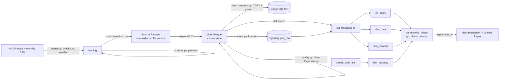

# Data dictionary

Source: HM Land Registry Price Paid Data (England and Wales), published
monthly under the Open Government Licence v3.0
(https://www.gov.uk/about-the-price-paid-data). Address data carries extra
conditions from Royal Mail and Ordnance Survey, so street-level fields never
leave the local layers or Postgres, and the dashboard shows aggregates only.

## Lineage

dbt also generates column-level docs and a lineage graph:
`cd dbt && dbt docs generate --profiles-dir . && dbt docs serve --profiles-dir .`

## Silver: `data/silver/sale_year=YYYY/*.parquet`

| Column | Type | Description | Rules |
|---|---|---|---|
| transaction_id | string | HMLR unique ID, `{GUID}` upper case | unique, not null, GUID pattern |
| price | bigint | Price stated on the transfer deed, £ | > 0 |
| sale_date | date | Date of transfer (completion) | 1995-01-01 to today |
| sale_year, sale_month | int | Derived from sale_date; sale_year is the partition key | |
| postcode | string | Full postcode at time of sale; can be blank | 99% match UK pattern |
| postcode_outward | string | Part before the space, e.g. `M15` | |
| postcode_area | string | Leading letters, e.g. `M`, `NG` | |
| property_type | char | D Detached, S Semi-detached, T Terraced, F Flat/maisonette, O Other | in set |
| is_new_build | bool | Old/New flag = Y | |
| tenure | char | F Freehold, L Leasehold (U Unknown if present) | in set |
| paon / saon / street / locality | string | Address parts (local layers only) | |
| town_city, district, county | string | Postal town, local authority district, county | district, county not null |
| ppd_category | char | A standard price paid; B additional (repossessions, buy-to-let, non-private buyers) | in set |
| last_record_status | char | Status of the winning row: A or C (D rows are removed) | |
| source_file, load_seq | string, int | Which landed file the row came from and its load order | |

## Warehouse (dbt)

| Model | Grain | Notes |
|---|---|---|
| `stg_transactions` | one row per current sale | view; drops street-level address |
| `fct_sales` | one row per current sale | incremental; keys to all three dims |
| `dim_date` | one row per day, first to last sale | `date_key` = YYYYMMDD; UK tax year |
| `dim_location` | one row per district + county | surrogate key = md5(district, county) |
| `dim_property` | type × tenure × new build | junk dimension from seeds |
| `rpt_monthly_prices` | month × property type | category A only; median and mean |
| `rpt_district_annual` | district × year | median, YoY change (LAG), rank in year |

## Known caveats
- The latest month is incomplete: HMLR keeps adding late registrations for
  months after first publication. The dashboard labels it "still filling in".
- Category B sales are excluded from reporting marts (HMLR's own statistics
  do the same) but kept in the fact table.
- Medians are exact on DuckDB and approximate on BigQuery.
