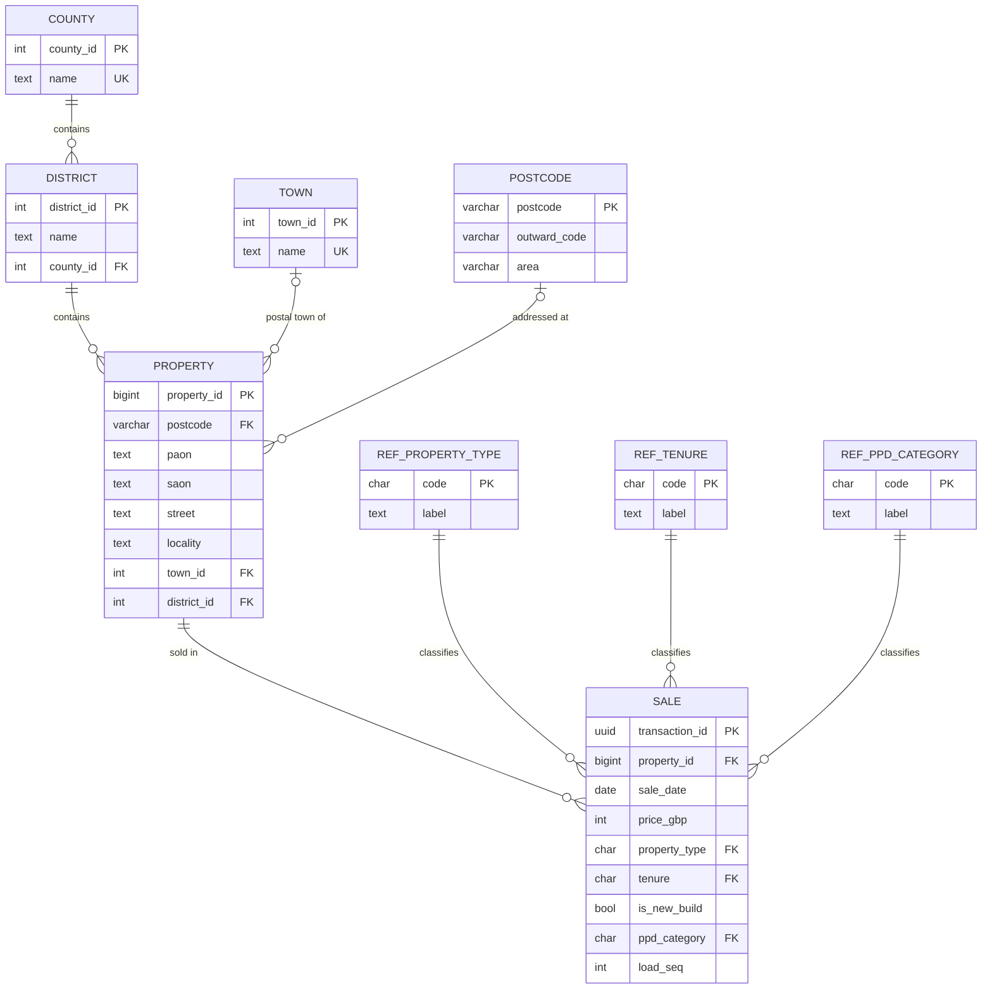
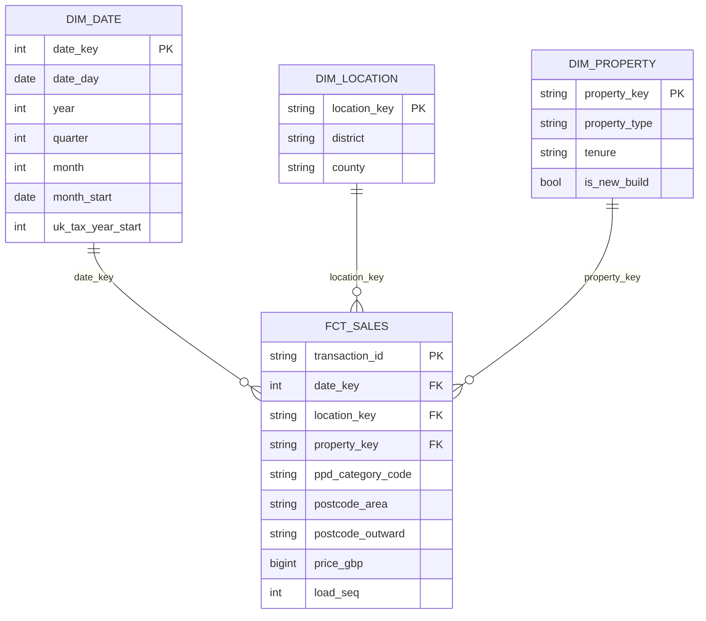

# Entity relationship diagrams

## PostgreSQL: normalised operational model (`postgres/migrations/`)

Why the attributes sit where they do:
- Property type, tenure and new-build flag are on **SALE**, not PROPERTY: the
  same address can be sold as a new build once and as established later, and
  conversions change type.
- **PROPERTY** has a natural key of (postcode, PAON, SAON, street, district)
  enforced with `UNIQUE NULLS NOT DISTINCT`, plus a surrogate `property_id`.

## Warehouse: star schema (`dbt/models/marts/`)

The warehouse drops street-level address fields: the dashboard only needs
district and postcode area, and HM Land Registry's address data has its own
licence conditions.
